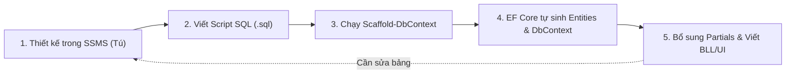

# Hướng dẫn repository - QuanLyKyTucXa (Database First Edition)

> Tài liệu định hướng cấu trúc, quy trình phát triển và kế hoạch nộp đồ án theo hướng **Entity Framework Core Database First**. Đây là hướng dẫn repository chuẩn mực, kế thừa toàn bộ cấu trúc Clean Architecture, phân quyền, báo cáo và các tiêu chí đạt điểm tối đa (10/10) của học phần Lập trình Windows Forms (.NET 9 & C# 12/13).

---

## 1. Mục tiêu và phạm vi

Repository `QuanLyKyTucXa` được định hướng cho ứng dụng quản lý ký túc xá trên nền tảng **Windows Forms, C# 12/13, .NET 9 trở lên và SQL Server (LocalDB/Express)**. Đây là ứng dụng desktop WinForms làm sản phẩm trọng tâm bắt buộc, không thay thế bằng web hay mobile.

Các nguyên tắc thiết kế bắt buộc:

- **Kiến trúc phân tầng rõ rệt (Clean Architecture / Multi-Project):** Tách riêng thành các project .NET độc lập gồm UI (`WinForms`), BLL (`Application`), DAL (`Infrastructure`) và Core (`Domain`). Tuyệt đối không viết logic nghiệp vụ hay truy vấn SQL trực tiếp trong code-behind của Form.
- **Phương pháp tiếp cận CSDL: EF Core Database First.**
  - CSDL SQL Server được thiết kế chuẩn hóa (khóa chính, khóa ngoại, ràng buộc, chỉ mục) và kiểm thử trước trong SQL Server Management Studio (SSMS).
  - Sử dụng cơ chế **Scaffolding (Reverse Engineering)** của EF Core để tự động sinh các Class Entity và `AppDbContext`.
  - Kết hợp mẫu thiết kế **Partial Classes** trong `Domain` để bổ sung thuộc tính tính toán, logic hiển thị mà không lo bị ghi đè khi cập nhật lại CSDL.
  - Có ít nhất một chức năng minh họa **ADO.NET thuần** (`SqlCommand`/`SqlDataReader`) độc lập để đối chiếu với EF Core theo đúng yêu cầu Chương 7.
- **Phân quyền người dùng:** Tối thiểu hai nhóm quyền (**Người dùng/Nhân viên** và **Quản trị viên/Quản lý**). Kiểm soát quyền ở cả giao diện (ẩn/hiện menu) lẫn tầng nghiệp vụ (Service validation).
- **Giao diện chuẩn Desktop WinForms:** Dùng `LoginForm` và `MainForm`; điều hướng bằng `MenuStrip` / `ToolStrip` / `TabControl`, Form con mở theo mô hình MDI Child hoặc UserControl nhúng trong Panel. Không sử dụng bố cục hoặc thuật ngữ kiểu website.
- **Tác vụ nền & I/O:** Import/Export Excel (ClosedXML/EPPlus) chạy bất đồng bộ (`async/await`, `Task`), có thanh `ProgressBar` chống đơ UI. Báo cáo xuất PDF/Excel hỗ trợ lọc theo tiêu chí.
- **Trực quan hóa dữ liệu:** Biểu đồ Dashboard lấy số liệu thực tế từ SQL Server, vẽ bằng GDI+ hoặc thư viện chuyên dụng (LiveCharts2/OxyPlot).
- **Triển khai & Vận hành:** Xử lý ngoại lệ toàn cục, ghi log hệ thống bằng Serilog, đóng gói publish độc lập (Self-contained) chạy được trên máy tính khác.

---

## 2. Cây thư mục mục tiêu (Chuẩn hóa Database First & Bỏ lồng `apps/desktop`)

Cấu trúc dưới đây đưa project WinForms vào chung thư mục `src/` để đường dẫn gọn gàng, tránh lỗi giới hạn ký tự (Max Path) trên Windows và đồng bộ hoàn hảo với Visual Studio 2022:

```text
QuanLyKyTucXa/
├── src/
│   │   # =====================================================================
│   │   # 1. PRESENTATION LAYER (UI): Giao diện Windows Forms .NET 9
│   │   # =====================================================================
│   ├── QuanLyKyTucXa.WinForms/
│   │   ├── Forms/
│   │   │   ├── Auth/                          # Tú: LoginForm.cs, ChangePasswordForm.cs
│   │   │   ├── Main/                          # Tú: MainForm.cs, DashboardForm.cs
│   │   │   ├── Residents/                     # Bổn: Quản lý sinh viên, tiếp nhận đăng ký KTX
│   │   │   ├── Rooms/                         # Bảo: Tòa nhà, phòng, sơ đồ giường
│   │   │   ├── Contracts/                     # Bảo: Hợp đồng lưu trú, gia hạn, chuyển/trả phòng
│   │   │   ├── Utilities/                     # Quy: Ghi chỉ số điện nước, bảng giá dịch vụ
│   │   │   ├── Invoices/                      # Quy: Lập hóa đơn, thu tiền, VietQR
│   │   │   ├── Incidents/                     # Đạt: Tiếp nhận & xử lý phản ánh sự cố
│   │   │   ├── Reports/                       # Đạt: Xuất báo cáo, in ấn (PrintPreviewDialog)
│   │   │   └── Users/                         # Tú: Quản trị tài khoản người dùng
│   │   ├── Controls/                          # UserControl tái sử dụng (UcRoomCard, UcStatCard)
│   │   ├── ViewModels/                        # Dữ liệu phục vụ riêng cho DataBinding Form
│   │   ├── Helpers/                           # SessionManager, UITheme, ControlExtensions, DialogHelper
│   │   ├── Resources/                         # Icons, Images (ảnh minh họa phòng/tòa nhà)
│   │   ├── Properties/
│   │   ├── Program.cs                         # Cấu hình DI, Serilog, bắt lỗi toàn cục
│   │   ├── appsettings.json                   # Chuỗi kết nối ConnectionString (không lưu pass thật)
│   │   └── QuanLyKyTucXa.WinForms.csproj
│   │
│   │   # =====================================================================
│   │   # 2. DOMAIN LAYER: Thực thể sinh từ CSDL & Phần mở rộng
│   │   # =====================================================================
│   ├── QuanLyKyTucXa.Domain/
│   │   ├── Entities/                          # 🤖 EF Core SCAFFOLD TỰ SINH (Không sửa tay file này)
│   │   │   ├── NguoiDung.cs
│   │   │   ├── SinhVien.cs
│   │   │   ├── ToaNha.cs
│   │   │   ├── Phong.cs
│   │   │   ├── Giuong.cs
│   │   │   ├── DangKyKtx.cs
│   │   │   ├── HopDong.cs
│   │   │   ├── BangGia.cs
│   │   │   ├── ChiSoDienNuoc.cs
│   │   │   ├── HoaDon.cs
│   │   │   ├── ChiTietHoaDon.cs
│   │   │   ├── ThanhToan.cs
│   │   │   └── SuCo.cs
│   │   ├── Partials/                          # ⭐ PARTIAL CLASSES (Thêm logic/thuộc tính tùy biến an toàn)
│   │   │   ├── SinhVien.Partial.cs            # VD: public string HoTen => $"{Ho} {Ten}";
│   │   │   ├── Phong.Partial.cs               # VD: public bool ConCho => SoChoTrong > 0;
│   │   │   └── HoaDon.Partial.cs
│   │   ├── Enums/                             # Ánh xạ trạng thái số sang Enum C# rõ nghĩa
│   │   │   ├── VaiTroEnum.cs
│   │   │   ├── TrangThaiPhongEnum.cs
│   │   │   ├── TrangThaiGiuongEnum.cs
│   │   │   ├── TrangThaiDangKyEnum.cs
│   │   │   ├── TrangThaiHopDongEnum.cs
│   │   │   └── TrangThaiHoaDonEnum.cs
│   │   └── Interfaces/                        # Hợp đồng trừu tượng (IRepository, IUnitOfWork)
│   │
│   │   # =====================================================================
│   │   # 3. APPLICATION LAYER (BLL): Xử lý nghiệp vụ & Use Cases
│   │   # =====================================================================
│   ├── QuanLyKyTucXa.Application/
│   │   ├── Interfaces/                        # Interface cho từng Service (IAuthService, ISinhVienService...)
│   │   ├── Services/                          # Cài đặt logic nghiệp vụ chia theo thành viên
│   │   │   ├── AuthService.cs                 # Tú
│   │   │   ├── SinhVienService.cs             # Bổn
│   │   │   ├── DangKyKtxService.cs            # Bổn
│   │   │   ├── PhongGiuongService.cs          # Bảo
│   │   │   ├── HopDongService.cs              # Bảo
│   │   │   ├── DienNuocService.cs             # Quy (chia tiền theo đầu người)
│   │   │   ├── HoaDonService.cs               # Quy
│   │   │   ├── SuCoService.cs                 # Đạt
│   │   │   └── ThongKeService.cs              # Đạt (tổng hợp số liệu Dashboard)
│   │   ├── DTOs/                              # Data Transfer Objects trao đổi giữa UI và Service
│   │   ├── Validators/                        # Kiểm tra hợp lệ dữ liệu nghiệp vụ
│   │   └── Reports/                           # Định dạng dữ liệu xuất báo cáo
│   │
│   │   # =====================================================================
│   │   # 4. INFRASTRUCTURE LAYER (DAL): CSDL & Tích hợp dịch vụ ngoài
│   │   # =====================================================================
│   └── QuanLyKyTucXa.Infrastructure/
│       ├── Data/
│       │   ├── Context/
│       │   │   └── AppDbContext.cs            # 🤖 File DbContext sinh ra từ lệnh Scaffold
│       │   └── scaffold-cmd.txt               # Lưu sẵn câu lệnh Scaffold để chạy lại khi sửa DB
│       ├── Repositories/                      # Cài đặt Repository Pattern với EF Core LINQ/Async
│       │   ├── BaseRepository.cs
│       │   ├── SinhVienRepository.cs
│       │   ├── PhongRepository.cs
│       │   └── HoaDonRepository.cs
│       ├── AdoNet/                            # 🏆 MINH CHỨNG ADO.NET THUẦN (Rubric Chương 7)
│       │   ├── DatabaseHelper.cs              # SqlConnection, SqlTransaction, SqlCommand
│       │   └── AdoBaoCaoRepository.cs         # Chạy Stored Procedure hoặc câu lệnh SQL tổng hợp
│       ├── ImportExport/                      # ClosedXML / EPPlus (Excel async, ProgressBar)
│       ├── Reporting/                         # FastReport / iTextSharp / PrintPreview engine
│       ├── Logging/                           # Cấu hình Serilog ghi file hàng ngày
│       └── ExternalServices/                 # VietQR API (HttpClient async) / AI Assistant
│
│   # =========================================================================
│   # 5. CƠ SỞ DỮ LIỆU: TRỌNG TÂM CỦA DATABASE FIRST
│   # =========================================================================
├── database/
│   ├── scripts/
│   │   ├── 01_CreateDatabase_Tables.sql       # Script tạo CSDL, toàn bộ bảng, PK, FK, Constraints
│   │   ├── 02_CreateIndexes_Triggers.sql      # Chỉ mục tăng tốc tìm kiếm, Trigger nghiệp vụ
│   │   ├── 03_StoredProcedures_Views.sql      # SP phục vụ ADO.NET và báo cáo
│   │   └── 04_InsertSampleData.sql            # Dữ liệu mẫu hoàn chỉnh (sinh viên, phòng, hóa đơn)
│   ├── backups/                               # File QuanLyKTX.bak dùng để nộp/restore nhanh
│   └── README.md                              # Hướng dẫn chi tiết cách chạy script và restore
│
├── docs/                                      # HỒ SƠ ĐỒ ÁN (Ăn trọn 1.0đ Báo cáo & Trình bày)
│   ├── requirements/
│   │   ├── assignment-mapping.md              # Bảng đối chiếu yêu cầu môn học -> Code minh chứng
│   │   └── acceptance-checklist.md            # Bảng tiêu chí nghiệm thu Pass/Fail
│   ├── use-case/
│   │   ├── use-cases.md                       # Đặc tả các ca sử dụng
│   │   └── role-permissions.md               # Ma trận phân quyền 3 vai trò
│   ├── erd/
│   │   ├── erd.png                            # Ảnh sơ đồ quan hệ thực thể trích xuất từ SSMS
│   │   └── DatabaseDictionary.md              # Từ điển dữ liệu (tên cột, kiểu dữ liệu, ý nghĩa)
│   ├── architecture/
│   │   ├── overview.md                        # Sơ đồ kiến trúc Clean Architecture
│   │   └── EFCore_vs_ADONET.md                # So sánh đối chiếu kỹ thuật (Chương 7)
│   ├── task-assignment.md                     # Phân công 5 thành viên (Tú, Bổn, Bảo, Quy, Đạt)
│   ├── installation.md                        # Hướng dẫn cài đặt từ mã nguồn
│   ├── screenshots/                           # Ảnh chụp thực tế các Form khi ứng dụng chạy
│   └── reports/
│       ├── final-report.docx                  # Báo cáo Word hoàn chỉnh nộp giảng viên
│       └── demo-script.md                     # Kịch bản thuyết trình demo 3-5 phút
│
├── tests/                                     # KIỂM THỬ ĐƠN VỊ & TÍCH HỢP
│   └── QuanLyKyTucXa.Tests/                   # Test nghiệp vụ Application (Tính tiền, validation)
│
├── scripts/                                   # SCRIPT TỰ ĐỘNG HÓA POWERSHELL
│   ├── dev/
│   │   └── run-scaffold.ps1                   # Script tự động chạy lệnh Scaffold DB một click
│   └── publish/
│       └── publish-selfcontained.ps1          # Script đóng gói file .exe độc lập
│
├── artifacts/                                 # THƯ MỤC CHỨA SẢN PHẨM XUẤT RA
│   ├── publish/                               # File .exe sau khi publish
│   └── demo/                                  # Video quay màn hình demo (nếu có)
│
├── .github/
│   ├── workflows/
│   │   └── build.yml                          # GitHub Actions CI tự động build khi tạo PR
│   └── pull_request_template.md               # Mẫu mô tả khi nộp code
│
├── .editorconfig
├── .gitignore                                 # Bỏ qua bin/, obj/, .vs/, file tạm
├── QuanLyKyTucXa.sln                          # File Solution quản lý 4 project
└── README.md
```

---

## 3. Quy trình vận hành chuẩn Database First

Trong quy trình Database First, **SQL Server là cội nguồn của mọi dữ liệu (Single Source of Truth)**. Nhóm triển khai theo 4 bước khép kín:



### Lệnh Scaffolding chính thức của dự án:
Mở **Package Manager Console** trong Visual Studio, chọn Default Project là `QuanLyKyTucXa.Infrastructure` và chạy:

```powershell
Scaffold-DbContext "Server=localhost;Database=QuanLyKTXDB;Trusted_Connection=True;TrustServerCertificate=True;" Microsoft.EntityFrameworkCore.SqlServer -OutputDir ../QuanLyKyTucXa.Domain/Entities -ContextDir Data/Context -Context AppDbContext -Force
```

* **Cờ `-Force`:** Khi Tú thay đổi bất kỳ cột hay bảng nào trong SQL Server, chỉ cần chạy lại lệnh này. EF Core sẽ tự động cập nhật đè lên các Entity trong `Domain/Entities` và `AppDbContext`.
* **Kỹ thuật Partial Class:** Vì các file trong `Domain/Entities/` sẽ bị ghi đè khi scaffold lại, mọi thuộc tính tự viết thêm (như nối chuỗi Họ + Tên, trạng thái hiển thị) phải được đặt trong thư mục `Domain/Partials/` với từ khóa `partial class` cùng tên.

---

## 4. Tạo file theo giai đoạn 14 ngày

### Giai đoạn A - Khởi tạo nền tảng (Ngày 1 - 4)
- **Tú:** Hoàn thiện `QuanLyKyTucXa.sln` với 4 project (`WinForms`, `Application`, `Infrastructure`, `Domain`). Thiết lập Project Reference đúng chiều.
- **Tú:** Viết `01_CreateDatabase_Tables.sql` và `04_InsertSampleData.sql`. Chạy thử trên SQL Server.
- **Tú:** Chạy lệnh `Scaffold-DbContext` để sinh ra toàn bộ Entities và `AppDbContext`. Commit lên nhánh `main`.
- **Cả nhóm:** Pull nhánh `main` về máy, mở Solution bấm `Ctrl + Shift + B` build thành công ngay lập tức mà không cần tự cấu hình database.

### Giai đoạn B - Triển khai chức năng theo phân công (Ngày 5 - 10)
- Từng thành viên làm việc độc lập trên branch chức năng:
  - **Tú:** `AuthService`, `LoginForm`, `MainForm` phân quyền MenuStrip.
  - **Bổn:** `SinhVienService`, `FrmSinhVien`, `FrmDangKyKTX`.
  - **Bảo:** `PhongGiuongService`, `HopDongService`, `FrmToaNha`, `FrmPhong`, `FrmGiuong`.
  - **Quy:** `DienNuocService`, `HoaDonService`, `FrmChiSoDienNuoc`, `FrmHoaDon`, `FrmThanhToan`.
  - **Đạt:** `ThongKeService`, `SuCoService`, `DashboardForm`, `FrmSuCo`.
- Tạo Pull Request theo mẫu, kiểm tra build và merge vào `main`.

### Giai đoạn C - Hoàn thiện, nghiệm thu & đóng gói (Ngày 11 - 14)
- Tạo tài liệu đối chiếu `EFCore_vs_ADONET.md` và kiểm thử chức năng ADO.NET thuần.
- Chạy script `publish-selfcontained.ps1` để xuất bản file `.exe` chạy thử nghiệm trên máy tính khác (máy không có Visual Studio).
- Chụp ảnh màn hình các Form đưa vào `docs/screenshots/`.
- Xuất file backup `QuanLyKTX.bak` và kiểm tra lại toàn bộ kịch bản demo 3-5 phút.

---

## 5. Ánh xạ yêu cầu Chương 1-9 (Thang điểm 10)

| Chương | Nội dung công nghệ | Triển khai thực tế trong Repository |
|---|---|---|
| **1** | Cấu trúc .NET 9, NuGet | Tách rõ 4 project (`UI/Application/Infrastructure/Domain`). Sử dụng các gói NuGet: `Microsoft.EntityFrameworkCore.SqlServer`, `ClosedXML`, `Serilog`. |
| **2** | OOP, LINQ, Async/Await | Áp dụng kế thừa, Interface (`IRepository`, `IService`), Record DTO, xử lý danh sách bằng LINQ (`Select`, `Where`, `GroupBy`), truy vấn bất đồng bộ `ToListAsync()`, `SaveChangesAsync()`. |
| **3** | Controls, DataGridView, Desktop UI | `MainForm` điều hướng bằng `MenuStrip`/`ToolStrip`. Sử dụng trên 8 loại controls khác nhau. DataGridView binding dữ liệu trực tiếp từ SQL Server qua Service. Hỗ trợ DPI. |
| **4** | Validation & Sự kiện | Bắt lỗi nhập liệu chặt chẽ bằng `ErrorProvider` / `ValidatingEvent`. Phím tắt thao tác nhanh, tìm kiếm sinh viên/phòng có debounce. |
| **5** | I/O, Async Task & Progress | Xuất/Nhập dữ liệu Excel danh sách sinh viên hoặc chỉ số điện nước bằng `ClosedXML`. Tác vụ chạy trên luồng nền (`Task.Run`), hiển thị tiến độ trên `ProgressBar` không đơ UI. |
| **6** | GDI+ / Trực quan hóa dữ liệu | `DashboardForm` thể hiện biểu đồ tỷ lệ lấp đầy phòng và doanh thu theo tháng bằng dữ liệu thật từ SQL Server (dùng LiveCharts2 hoặc tự vẽ GDI+). |
| **7** | CSDL: EF Core & ADO.NET | **EF Core Database First:** Thực hiện toàn bộ các thao tác CRUD, Include/Join khóa ngoại giữa các bảng SinhVien - HopDong - Phong - HoaDon.<br>**ADO.NET thuần:** Thư mục `Infrastructure/AdoNet/` chứa code `SqlCommand`, `SqlDataReader` thực thi Stored Procedure thống kê hoặc nhập liệu hàng loạt. |
| **8** | Báo cáo & In ấn | Xuất hóa đơn tiền phòng/điện nước và hợp đồng lưu trú ra file PDF/Excel theo tiêu chí lọc thời gian. Hỗ trợ xem trước khi in bằng `PrintPreviewDialog`. |
| **9** | Đóng gói, Logging & REST API | Cấu hình Serilog ghi log lỗi hệ thống ra thư mục `Logs/`. Đóng gói bản chạy độc lập `self-contained`. Tích hợp REST API tạo mã thanh toán VietQR động qua `HttpClient async`. |

---

## 6. Checklist nghiệm thu trước khi bảo vệ

- [ ] Solution mở bằng Visual Studio 2022+, chọn **.NET 9.0**, build thành công không lỗi (0 Errors).
- [ ] CSDL có đầy đủ khóa chính (PK), khóa ngoại (FK), và dữ liệu mẫu phong phú trong file script/backup.
- [ ] Cơ chế Scaffolding hoạt động đúng, các Entity map khớp 100% với các bảng trong SQL Server.
- [ ] Đăng nhập đúng 2 nhóm quyền: Admin (toàn quyền) và Nhân viên (nghiệp vụ KTX); phân quyền rõ ràng trên menu.
- [ ] Luồng nghiệp vụ chạy thông suốt: Đăng ký KTX $\rightarrow$ Duyệt $\rightarrow$ Xếp giường $\rightarrow$ Ký hợp đồng $\rightarrow$ Nhập điện nước $\rightarrow$ Lập hóa đơn $\rightarrow$ Thanh toán.
- [ ] Chức năng ADO.NET thuần hoạt động độc lập và có tài liệu giải thích lý do đối chiếu với EF Core.
- [ ] Thao tác xuất Excel/PDF có ProgressBar, không bị đóng băng giao diện khi thao tác.
- [ ] Biểu đồ Dashboard phản ánh đúng số liệu đang có trong CSDL (thay đổi dữ liệu trong bảng thì biểu đồ đổi theo).
- [ ] Ứng dụng xử lý lỗi toàn cục, khi có lỗi phát sinh không bị crash mà hiện hộp thoại thông báo và ghi log Serilog.
- [ ] Bản publish `self-contained` chạy được trên máy tính Windows khác không cài sẵn .NET SDK.
- [ ] Thư mục mã nguồn nộp bài sạch sẽ, đã xóa toàn bộ thư mục rác `bin/` và `obj/`.
