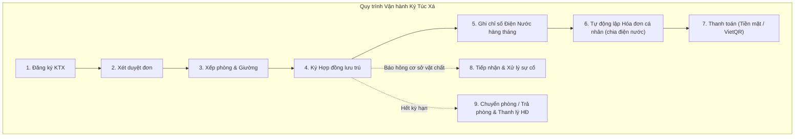

# 🏢 HỆ THỐNG QUẢN LÝ KÝ TÚC XÁ (QuanLyKyTucXa)

[](https://dotnet.microsoft.com/)
[](https://learn.microsoft.com/en-us/dotnet/csharp/)
[](#-kiến-trúc-hệ-thống)
[](#-cơ-sở-dữ-liệu--database-first)
[](https://studentdorm.atlassian.net/jira/software/projects/KAN/boards/2)
[](#)

> Ứng dụng Desktop chuyên nghiệp quản lý ký túc xá sinh viên trên nền tảng **Windows Forms (.NET 9 / C# 13)**, phát triển theo mô hình **Entity Framework Core Database-First** kết hợp **Clean Architecture** phân tầng độc lập. Đồ án học phần Lập trình trực quan (LTTQ) hướng tới chuẩn điểm tối đa (10/10).

---

## 📌 Mục lục
1. [Giới thiệu tổng quan](#-giới-thiệu-tổng-quan)
2. [Công nghệ sử dụng](#-công-nghệ-sử-dụng)
3. [Kiến trúc hệ thống & Cây thư mục](#-kiến-trúc-hệ-thống--cây-thư-mục)
4. [Các phân hệ chức năng](#-các-phân-hệ-chức-năng)
5. [Cơ sở dữ liệu & Database-First](#-cơ-sở-dữ-liệu--database-first)
6. [Hướng dẫn cài đặt & Khởi chạy](#-hướng-dẫn-cài-đặt--khởi-chạy)
7. [Tài khoản thử nghiệm](#-tài-khoản-thử-nghiệm-demo)
8. [Phân công thành viên nhóm](#-phân-công-thành-viên-nhóm)
9. [Đối chiếu tiêu chuẩn Rubric (10/10)](#-đối-chiếu-tiêu-chuẩn-rubric-1010)

---

## 📖 Giới thiệu tổng quan

Hệ thống **Quản lý Ký túc xá** giải quyết bài toán vận hành thực tế tại các trường đại học với 3 nhóm tác nhân chính:
* **Quản trị viên (Admin):** Quản trị tài khoản, danh mục tòa nhà, tầng, phòng, giường, biểu phí dịch vụ, xem thống kê doanh thu và báo cáo toàn diện.
* **Nhân viên KTX:** Quản lý hồ sơ sinh viên nội trú, tiếp nhận xét duyệt đơn đăng ký, sắp xếp phòng/giường, ký kết hợp đồng, giải quyết đổi/trả phòng, ghi nhận chỉ số điện nước, lập hóa đơn và theo dõi sự cố.
* **Sinh viên:** Tra cứu thông tin cá nhân, xem tình trạng phòng/giường, theo dõi hợp đồng lưu trú, nhận hóa đơn cá nhân hàng tháng (đã được chia sẻ điện nước phòng), thanh toán qua mã VietQR động và gửi phản ánh sự cố cơ sở vật chất.

---

## 🛠 Công nghệ sử dụng

| Lớp công nghệ | Chi tiết sử dụng |
|---|---|
| **Nền tảng & Ngôn ngữ** | .NET 9.0 / .NET 10.0, C# 12/13, Windows Forms Desktop Application |
| **Kiến trúc** | Clean Architecture (4-Layer: Presentation, Application, Infrastructure, Domain) |
| **Cơ sở dữ liệu & ORM** | SQL Server (LocalDB / Express), **Entity Framework Core Database-First** (`Scaffold-DbContext`) |
| **Minh chứng độc lập** | **ADO.NET thuần** (`SqlCommand`, `SqlDataReader`, `StoredProcedure`) minh chứng Chương 7 |
| **Tác vụ nền & I/O** | `async/await`, `Task.Run`, xuất/nhập Excel với **ClosedXML**, hiển thị tiến độ `ProgressBar` |
| **Trực quan hóa dữ liệu** | Biểu đồ Dashboard lấy số liệu thực tế qua **LiveCharts2** hoặc GDI+ |
| **Tích hợp mở rộng** | **VietQR REST API** (tạo mã QR chuyển khoản động theo từng hóa đơn), **Serilog** ghi log lỗi hệ thống |

---

## 🏛 Kiến trúc hệ thống & Cây thư mục

Dự án áp dụng mô hình phân tầng nghiêm ngặt, đưa toàn bộ 4 project về chung thư mục `src/` nhằm tối ưu đường dẫn và tránh lỗi Max Path trên Windows:

```text
QuanLyKyTucXa/
├── src/
│   ├── QuanLyKyTucXa.WinForms/            # 1. PRESENTATION LAYER (UI)
│   │   ├── Forms/                         # Form chức năng phân theo module thành viên
│   │   │   ├── Auth/                      # LoginForm, ChangePasswordForm (Tú)
│   │   │   ├── Main/                      # MainForm điều hướng MenuStrip, DashboardForm (Tú, Đạt)
│   │   │   ├── Residents/                 # Quản lý sinh viên, tiếp nhận đăng ký KTX (Bổn)
│   │   │   ├── Rooms/                     # Tòa nhà, phòng, sơ đồ giường (Bảo)
│   │   │   ├── Contracts/                 # Hợp đồng lưu trú, gia hạn, chuyển/trả phòng (Bảo)
│   │   │   ├── Utilities/                 # Ghi chỉ số điện nước, bảng giá dịch vụ (Quy)
│   │   │   ├── Invoices/                  # Lập hóa đơn, thu tiền, VietQR API (Quy)
│   │   │   ├── Incidents/                 # Tiếp nhận & cập nhật xử lý sự cố (Đạt)
│   │   │   ├── Reports/                   # Xuất báo cáo, in ấn PrintPreviewDialog (Đạt)
│   │   │   └── Users/                     # Quản trị tài khoản người dùng (Tú)
│   │   ├── Controls/                      # UserControls tái sử dụng (UcRoomCard, UcStatCard)
│   │   ├── ViewModels/                    # Model dữ liệu riêng cho DataBinding Form
│   │   ├── Helpers/                       # SessionManager, Theme, ControlExtensions
│   │   ├── Resources/                     # Icons, hình ảnh giao diện
│   │   └── Program.cs                     # Cấu hình Dependency Injection, Serilog, bắt lỗi toàn cục
│   │
│   ├── QuanLyKyTucXa.Application/         # 2. APPLICATION LAYER (BLL)
│   │   ├── Interfaces/                    # Interface dịch vụ (IAuthService, ISinhVienService...)
│   │   ├── Services/                      # Cài đặt logic nghiệp vụ phân chia theo thành viên
│   │   ├── DTOs/                          # Data Transfer Objects trao đổi giữa Form và Service
│   │   ├── Validators/                    # Kiểm tra tính hợp lệ của dữ liệu nghiệp vụ
│   │   └── Reports/                       # Định dạng dữ liệu xuất báo cáo
│   │
│   ├── QuanLyKyTucXa.Infrastructure/      # 3. INFRASTRUCTURE LAYER (DAL)
│   │   ├── Data/Context/AppDbContext.cs   # DbContext sinh tự động từ Scaffold EF Core
│   │   ├── Repositories/                  # Cài đặt Repository Pattern với EF Core LINQ/Async
│   │   ├── AdoNet/                        # Minh chứng ADO.NET thuần độc lập (Chương 7)
│   │   ├── ImportExport/                  # ClosedXML (Excel bất đồng bộ kèm ProgressBar)
│   │   ├── Logging/                       # Cấu hình Serilog ghi file hàng ngày
│   │   └── ExternalServices/              # VietQR API (HttpClient async)
│   │
│   └── QuanLyKyTucXa.Domain/              # 4. DOMAIN LAYER (CORE)
│       ├── Entities/                      # Entity sinh tự động từ Scaffold (KHÔNG sửa tay)
│       ├── Partials/                      # ⭐ PARTIAL CLASSES mở rộng thuộc tính tính toán an toàn
│       └── Enums/                         # Ánh xạ trạng thái số sang Enum C# rõ nghĩa
│
├── database/
│   ├── scripts/
│   │   ├── 01_CreateDatabase_Tables.sql   # Khởi tạo DB, 13 bảng thực thể & toàn bộ CHECK constraints
│   │   ├── 02_CreateIndexes_Triggers.sql  # Filtered Unique Indexes & Triggers toàn vẹn dữ liệu
│   │   ├── 03_StoredProcedures_Views.sql  # Views báo cáo & SP tự động chia điện nước theo phòng
│   │   └── 04_InsertSampleData.sql        # Dữ liệu mẫu phong phú phục vụ demo
│   └── README.md                          # Hướng dẫn chi tiết cách chạy script và mã hóa UTF-8
│
├── docs/                                  # HỒ SƠ ĐỒ ÁN
│   ├── reports/
│   │   └── HuongDanTrienKhaiDoAn_14Ngay_DatabaseFirst.docx # Tài liệu Word hướng dẫn quy trình
│   ├── task-assignment.md                 # Kế hoạch chi tiết 14 ngày & ma trận phân công
│   └── screenshots/                       # Ảnh chụp giao diện thực tế của hệ thống
│
├── scripts/
│   └── dev/run-scaffold.ps1               # Script PowerShell tự động chạy Scaffold EF Core 1-click
├── QuanLyKyTucXa.slnx                     # Solution Visual Studio 2022+
└── README.md
```

---

## ⚡ Các phân hệ chức năng



* **Phân quyền 2 cấp độ:** Admin và Nhân viên được kiểm soát chặt chẽ ở cả giao diện (`MenuStrip` tự động ẩn/hiện) lẫn tầng dịch vụ (`Service validation`).
* **Quản lý Lưu trú & Sơ đồ Giường:** Trực quan hóa tình trạng từng giường (Trống / Đang sử dụng / Hỏng). Ngăn chặn tuyệt đối việc xếp vượt sức chứa nhờ Filtered Unique Index ở CSDL.
* **Hóa đơn cá nhân & Chia tiền điện nước (Phương án A):** Chỉ số điện nước chốt theo phòng, hệ thống tự động nhân đơn giá và chia đều cho số sinh viên thực tế đang ở tại thời điểm chốt, sinh hóa đơn cá nhân kèm chi tiết rõ ràng.
* **Thanh toán VietQR động:** Tự động sinh mã VietQR theo chuẩn Napas chứa đúng số tiền và nội dung chuyển khoản, thanh toán xong tự động cập nhật công nợ về 0.
* **Dashboard thời gian thực:** Thống kê tỷ lệ lấp đầy phòng, doanh thu 12 tháng, hóa đơn nợ quá hạn và sự cố cần xử lý.

---

## 🗄 Cơ sở dữ liệu & Database-First

Dự án áp dụng phương pháp **Database-First**: Cơ sở dữ liệu SQL Server là cội nguồn của mọi dữ liệu.

### Quy trình cập nhật Schema:
1. Chỉnh sửa bảng, cột, khóa ngoại hoặc ràng buộc `CHECK` trong thư mục `database/scripts/`.
2. Thực thi script vào SQL Server.
3. Chạy lệnh Scaffolding để EF Core tự động sinh đè các Entity C# và `AppDbContext`:

```powershell
# Chạy script tự động có sẵn trong repository:
powershell -ExecutionPolicy Bypass -File scripts/dev/run-scaffold.ps1

# Hoặc chạy lệnh .NET CLI tại thư mục gốc:
dotnet ef dbcontext scaffold "Server=(localdb)\MSSQLLocalDB;Database=QuanLyKTXDB;Trusted_Connection=True;TrustServerCertificate=True;" Microsoft.EntityFrameworkCore.SqlServer --project src/QuanLyKyTucXa.Infrastructure --startup-project src/QuanLyKyTucXa.WinForms --output-dir ../QuanLyKyTucXa.Domain/Entities --context-dir Data/Context --context AppDbContext --force
```

> **Quy tắc an toàn (Partial Class):** Mọi thuộc tính tính toán hoặc logic bổ trợ hiển thị Form phải được viết trong thư mục `src/QuanLyKyTucXa.Domain/Partials/` bằng từ khóa `public partial class` để không bị mất khi chạy lại Scaffold.

---

## 🚀 Hướng dẫn cài đặt & Khởi chạy

### Yêu cầu tiên quyết:
* **Hệ điều hành:** Windows 10/11
* **IDE:** Visual Studio 2022 (v17.8 trở lên) có cài đặt workload *.NET Desktop Development*
* **SDK:** .NET 9.0 SDK hoặc .NET 10.0 SDK
* **Database:** SQL Server (LocalDB / Express / Standard)

### Các bước thực hiện:

1. **Clone repository về máy:**
   ```bash
   git clone https://github.com/<your-username>/QuanLyKyTucXa.git
   cd QuanLyKyTucXa
   ```

2. **Khởi tạo Cơ sở dữ liệu (SQL Server):**
   Mở PowerShell tại thư mục gốc và chạy 4 file script theo đúng thứ tự (sử dụng cờ `-f 65001` để bảo toàn mã hóa tiếng Việt):
   ```powershell
   sqlcmd -f 65001 -S "(localdb)\MSSQLLocalDB" -i database\scripts\01_CreateDatabase_Tables.sql
   sqlcmd -f 65001 -S "(localdb)\MSSQLLocalDB" -i database\scripts\02_CreateIndexes_Triggers.sql
   sqlcmd -f 65001 -S "(localdb)\MSSQLLocalDB" -i database\scripts\03_StoredProcedures_Views.sql
   sqlcmd -f 65001 -S "(localdb)\MSSQLLocalDB" -i database\scripts\04_InsertSampleData.sql
   ```

3. **Mở Solution và Build:**
   * Mở file `QuanLyKyTucXa.slnx` bằng Visual Studio 2022+.
   * Nhấn `Ctrl + Shift + B` để build toàn bộ 4 project (kết quả: 0 Errors, 0 Warnings).
   * Nhấn `F5` để khởi chạy ứng dụng.

---

## 🔑 Tài khoản thử nghiệm (Demo)

> Tất cả tài khoản demo đều có mật khẩu mặc định là: **`123456`**

| Tên đăng nhập | Vai trò | Tên người dùng | Quyền hạn truy cập |
|---|---|---|---|
| **`admin`** | Quản trị viên | Quản trị viên Hệ thống | Toàn quyền quản trị hệ thống, tài khoản, cấu hình biểu phí và thống kê |
| **`nhanvien01`** | Nhân viên | Nguyễn Văn Quản Lý | Quản lý sinh viên, tiếp nhận xét duyệt, hợp đồng, phòng, điện nước & hóa đơn |
| **`sv2026001`** | Sinh viên | Nguyễn Văn An | Sinh viên phòng A1-101 (xem phòng, hóa đơn cá nhân, báo hỏng sự cố) |
| **`sv2026002`** | Sinh viên | Trần Thị Bình | Sinh viên phòng B2-101 |

---

## 👥 Phân công thành viên nhóm

Quản lý tiến độ dự án trên [Jira Board (KAN)](https://studentdorm.atlassian.net/jira/software/projects/KAN/boards/2):

| Thành viên | Vai trò | Phân hệ phụ trách chính |
|---|---|---|
| **Tú** *(Trưởng nhóm)* | Software Architect & Backend | Kiến trúc Solution, Quản trị CSDL (Script 01-04, Scaffold EF Core), `AuthService`, `LoginForm`, `MainForm` phân quyền MenuStrip, quản lý tài khoản. |
| **Bổn** | Developer | Phân hệ Sinh viên & Tiếp nhận KTX: `SinhVienService`, `DangKyKtxService`, `FrmSinhVien`, `FrmDangKyKtx`, Import/Export Excel hồ sơ sinh viên. |
| **Bảo** | Developer | Phân hệ Phòng & Hợp đồng: `PhongGiuongService`, `HopDongService`, `FrmToaNha`, `FrmPhong`, `FrmGiuong` (sơ đồ giường), chuyển phòng & thanh lý hợp đồng. |
| **Quy** | Developer | Phân hệ Biểu phí & Tài chính: `DienNuocService`, `HoaDonService`, `FrmChiSoDienNuoc`, `FrmHoaDon` (chia tiền điện nước theo phòng), thanh toán VietQR API. |
| **Đạt** | Developer & QA | Phân hệ Sự cố & Báo cáo: `SuCoService`, `ThongKeService`, `FrmSuCo`, `DashboardForm` (LiveCharts2/GDI+), In ấn báo cáo (`PrintPreviewDialog`), minh chứng ADO.NET thuần. |

---

## 📊 Đối chiếu tiêu chuẩn Rubric (10/10)

| Chương môn học | Nội dung kỹ thuật yêu cầu | Minh chứng thực tế trong Repository | Điểm |
|---|---|---|:---:|
| **Chương 1-2** | Cấu trúc .NET 9, Clean Architecture, OOP, LINQ, Async/Await | Phân tầng rõ rệt 4 project; Service, Repository, DTO; LINQ Async (`ToListAsync()`, `SaveChangesAsync()`). | 1.0 |
| **Chương 3** | Controls, DataGridView, Điều hướng Desktop MDI/MenuStrip, DPI | `MainForm` điều hướng MenuStrip; DataGridView binding dữ liệu thật từ SQL Server; hỗ trợ độ phân giải cao. | 1.0 |
| **Chương 4** | Sự kiện, Validation dữ liệu, ErrorProvider, Phím tắt | Kiểm tra lỗi nhập liệu chặt chẽ bằng `ErrorProvider`; phím tắt thao tác nhanh (`Ctrl+S`, `F5`); tìm kiếm realtime. | 1.0 |
| **Chương 5** | I/O, Excel ClosedXML, Tác vụ nền Async & ProgressBar | Xuất/Nhập danh sách sinh viên qua Excel bằng ClosedXML chạy nền (`Task.Run`), có thanh `ProgressBar` chống đơ UI. | 1.0 |
| **Chương 6** | Trực quan hóa dữ liệu, GDI+ / LiveCharts2 Dashboard | `DashboardForm` hiển thị biểu đồ tỷ lệ lấp đầy phòng và doanh thu 12 tháng lấy từ CSDL thật qua Stored Procedure. | 0.5 |
| **Chương 7** | CSDL: EF Core Database First & Minh chứng ADO.NET thuần | EF Core CRUD 13 bảng; thư mục `Infrastructure/AdoNet/` chứa code `SqlCommand`, `SqlDataReader` chạy thủ tục độc lập. | 2.0 |
| **Chương 8** | Báo cáo, Xuất file & Xem trước khi in (PrintPreviewDialog) | Xuất hóa đơn tiền phòng/điện nước và hợp đồng ra file PDF/Excel theo bộ lọc; xem trước khi in bằng `PrintPreviewDialog`. | 1.5 |
| **Chương 9** | Đóng gói Publish Self-contained, Logging Serilog & REST API | Publish file `.exe` độc lập không cần cài .NET SDK; Serilog ghi nhật ký lỗi; tích hợp VietQR API tạo mã thanh toán động. | 1.0 |
| **Bảo vệ** | Báo cáo Word, Hồ sơ đồ án & Trả lời câu hỏi phản biện | Tài liệu Word [`HuongDanTrienKhaiDoAn_14Ngay_DatabaseFirst.docx`](docs/reports/); kịch bản demo 3-5 phút mạch lạc. | 1.0 |
| **TỔNG CỘNG** | **Điểm mục tiêu đạt được** | **Đầy đủ toàn bộ các tiêu chí nghiệm thu của học phần** | **10.0** |

---

*© 2026 Nhóm Đồ Án Ký Túc Xá - Học phần Lập trình trực quan. Giữ toàn quyền.*
